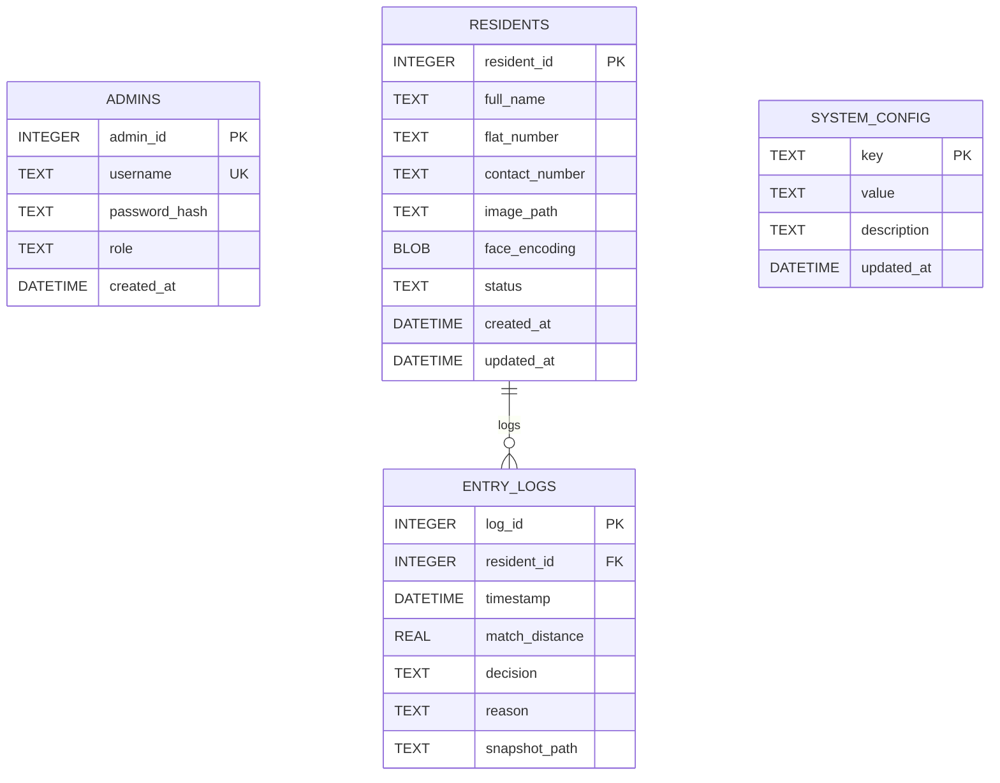

# Database, Evaluation Strategy, and API Design Specification
# Smart Society Security System

---

## 1. Database Architecture & Schema Design

The Smart Society Security System uses an embedded, thread-safe **SQLite 3** relational database engine. All database schemas are declared with strict typing, relational constraints, foreign keys, and indexes optimized for real-time reads during live camera recognition.

### 1.1 Entity-Relationship Overview



---

### 1.2 Data Dictionary & Table Definitions

#### 1.2.1 Table: `admins`
Stores authenticated administrative and security supervisor credentials.

| Column | Data Type | Constraints | Description |
|---|---|---|---|
| `admin_id` | `INTEGER` | `PRIMARY KEY AUTOINCREMENT` | Unique identifier for system administrators |
| `username` | `TEXT` | `NOT NULL UNIQUE COLLATE NOCASE` | Unique login username (case-insensitive) |
| `password_hash` | `TEXT` | `NOT NULL` | Bcrypt hashed salted password string |
| `role` | `TEXT` | `NOT NULL CHECK(role IN ('admin', 'operator'))` | Role-based authorization tier |
| `created_at` | `DATETIME` | `NOT NULL DEFAULT CURRENT_TIMESTAMP` | Administrator account creation timestamp |

#### 1.2.2 Table: `residents`
Stores registered resident profiles, operational status, and facial biometric embeddings.

| Column | Data Type | Constraints | Description |
|---|---|---|---|
| `resident_id` | `INTEGER` | `PRIMARY KEY AUTOINCREMENT` | Unique auto-generated resident ID |
| `full_name` | `TEXT` | `NOT NULL` | Full legal name of the resident |
| `flat_number` | `TEXT` | `NOT NULL` | Society flat/apartment identifier (e.g., "B-402") |
| `contact_number` | `TEXT` | `DEFAULT NULL` | Optional phone number |
| `image_path` | `TEXT` | `NOT NULL` | Relative path to local reference photograph |
| `face_encoding` | `BLOB` | `NOT NULL` | Serialized 512-d (or 128-d) NumPy float32 embedding vector |
| `status` | `TEXT` | `NOT NULL DEFAULT 'ACTIVE' CHECK(status IN ('ACTIVE', 'INACTIVE'))` | Status toggle for gate access authorization |
| `created_at` | `DATETIME` | `NOT NULL DEFAULT CURRENT_TIMESTAMP` | Profile creation timestamp |
| `updated_at` | `DATETIME` | `NOT NULL DEFAULT CURRENT_TIMESTAMP` | Last profile/embedding update timestamp |

#### 1.2.3 Table: `entry_logs`
Records every completed recognition attempt, verification decision, and audit trail metadata.

| Column | Data Type | Constraints | Description |
|---|---|---|---|
| `log_id` | `INTEGER` | `PRIMARY KEY AUTOINCREMENT` | Unique event log entry ID |
| `resident_id` | `INTEGER` | `DEFAULT NULL REFERENCES residents(resident_id) ON DELETE SET NULL` | ID of recognized resident; `NULL` for unrecognized/unknown persons |
| `timestamp` | `DATETIME` | `NOT NULL DEFAULT CURRENT_TIMESTAMP` | Timestamp of camera capture and decision |
| `match_distance` | `REAL` | `NOT NULL` | Computed metric distance (e.g. Cosine distance: 0.0 to 1.0+) |
| `decision` | `TEXT` | `NOT NULL CHECK(decision IN ('ENTRY_ALLOWED', 'ENTRY_REJECTED', 'VERIFICATION_REQUIRED'))` | Gate outcome: Green, Red, or Yellow |
| `reason` | `TEXT` | `NOT NULL` | Explicit explanation (e.g., "Match confident", "Unknown person", "Ambiguous match", "Low quality") |
| `snapshot_path` | `TEXT` | `DEFAULT NULL` | Relative path to optional incident frame capture |

#### 1.2.4 Table: `system_config`
Key-value store for runtime settings that can be customized via admin dashboard without code edits.

| Column | Data Type | Constraints | Description |
|---|---|---|---|
| `key` | `TEXT` | `PRIMARY KEY` | Configuration key (e.g., `ACCEPT_THRESHOLD`) |
| `value` | `TEXT` | `NOT NULL` | String representation of configuration value |
| `description` | `TEXT` | `DEFAULT NULL` | Human-readable explanation of setting |
| `updated_at` | `DATETIME` | `NOT NULL DEFAULT CURRENT_TIMESTAMP` | Timestamp of last modification |

---

### 1.3 SQL DDL Schema Definition (`database/schema.sql`)

```sql
-- Smart Society Security System SQLite Schema Initialization
PRAGMA foreign_keys = ON;

-- 1. Administrators Table
CREATE TABLE IF NOT EXISTS admins (
    admin_id INTEGER PRIMARY KEY AUTOINCREMENT,
    username TEXT NOT NULL UNIQUE COLLATE NOCASE,
    password_hash TEXT NOT NULL,
    role TEXT NOT NULL CHECK(role IN ('admin', 'operator')),
    created_at DATETIME NOT NULL DEFAULT CURRENT_TIMESTAMP
);

-- 2. Residents Table
CREATE TABLE IF NOT EXISTS residents (
    resident_id INTEGER PRIMARY KEY AUTOINCREMENT,
    full_name TEXT NOT NULL,
    flat_number TEXT NOT NULL,
    contact_number TEXT DEFAULT NULL,
    image_path TEXT NOT NULL,
    face_encoding BLOB NOT NULL,
    status TEXT NOT NULL DEFAULT 'ACTIVE' CHECK(status IN ('ACTIVE', 'INACTIVE')),
    created_at DATETIME NOT NULL DEFAULT CURRENT_TIMESTAMP,
    updated_at DATETIME NOT NULL DEFAULT CURRENT_TIMESTAMP
);

-- 3. Entry Logs Table
CREATE TABLE IF NOT EXISTS entry_logs (
    log_id INTEGER PRIMARY KEY AUTOINCREMENT,
    resident_id INTEGER DEFAULT NULL,
    timestamp DATETIME NOT NULL DEFAULT CURRENT_TIMESTAMP,
    match_distance REAL NOT NULL,
    decision TEXT NOT NULL CHECK(decision IN ('ENTRY_ALLOWED', 'ENTRY_REJECTED', 'VERIFICATION_REQUIRED')),
    reason TEXT NOT NULL,
    snapshot_path TEXT DEFAULT NULL,
    FOREIGN KEY (resident_id) REFERENCES residents(resident_id) ON DELETE SET NULL
);

-- 4. Runtime Configuration Table
CREATE TABLE IF NOT EXISTS system_config (
    key TEXT PRIMARY KEY,
    value TEXT NOT NULL,
    description TEXT,
    updated_at DATETIME NOT NULL DEFAULT CURRENT_TIMESTAMP
);

-- Indexes for Fast Lookups and High-Performance Live Video Querying
CREATE INDEX IF NOT EXISTS idx_residents_status ON residents(status);
CREATE INDEX IF NOT EXISTS idx_residents_flat ON residents(flat_number);
CREATE INDEX IF NOT EXISTS idx_entry_logs_timestamp ON entry_logs(timestamp DESC);
CREATE INDEX IF NOT EXISTS idx_entry_logs_resident_id ON entry_logs(resident_id);
CREATE INDEX IF NOT EXISTS idx_entry_logs_decision ON entry_logs(decision);

-- Trigger: Automatically update residents.updated_at timestamp upon modification
CREATE TRIGGER IF NOT EXISTS trg_residents_updated_at
AFTER UPDATE ON residents
FOR EACH ROW
BEGIN
    UPDATE residents SET updated_at = CURRENT_TIMESTAMP WHERE resident_id = OLD.resident_id;
END;
```

---

## 2. Evaluation Metrics and Strategy

Model performance must never be evaluated using live operational telemetry or arbitrary assumptions. It must be quantitatively measured against an offline, annotated, and isolated benchmark dataset.

### 2.1 Benchmark Evaluation Dataset Composition
The benchmark evaluation relies on a dedicated dataset separated from enrollment images:

| Data Segment | Entity Count | Images Per Entity | Total Attempts | Notes |
|---|---|---|---|---|
| **Registered Residents (Positive Class)** | 20 unique subjects | 3–5 distinct probe images | 100 test attempts | Captured across variations in lighting, pose (±15°), and facial expression |
| **Unknown Visitors / Impostors (Negative Class)** | 10 unknown subjects | 5 distinct probe images | 50 test attempts | Subjects completely absent from the registered residents database |
| **Total Evaluation Corpus** | **30 subjects** | **N/A** | **150 test attempts** | Zero image overlap between enrollment set and probe set |

---

### 2.2 Confusion Matrix Definitions

| Actual \ Predicted | Predicted Resident (`ENTRY_ALLOWED`) | Predicted Non-Resident (`ENTRY_REJECTED` / `VERIFY`) |
|---|---|---|
| **Actual Registered Resident** | **True Positive (TP)**: Correctly admitted resident | **False Negative (FN)**: Genuine resident incorrectly rejected or challenged (Type II Error) |
| **Actual Impostor / Unknown** | **False Positive (FP)**: Security Breach! Impostor wrongly admitted (Type I Error) | **True Negative (TN)**: Unknown person successfully stopped/flagged |

---

### 2.3 Mathematical Formulations of Metrics

1. **Classification Accuracy**:
   $$\text{Accuracy} = \frac{TP + TN}{TP + TN + FP + FN} \times 100\%$$

2. **False Acceptance Rate (FAR) / False Match Rate (FMR)**:
   *Critical security metric. Measures likelihood of granting entry to an intruder.*
   $$\text{FAR} = \frac{FP}{FP + TN} \times 100\%$$

3. **False Rejection Rate (FRR) / False Non-Match Rate (FNMR)**:
   *Convenience metric. Measures friction caused to authorized residents.*
   $$\text{FRR} = \frac{FN}{FN + TP} \times 100\%$$

4. **Precision**:
   $$\text{Precision} = \frac{TP}{TP + FP} \times 100\%$$

5. **Recall (Sensitivity / True Positive Rate)**:
   $$\text{Recall} = \frac{TP}{TP + FN} \times 100\%$$

6. **Equal Error Rate (EER)**:
   The calibrated operating threshold where $\text{FAR} \approx \text{FRR}$. The system operating point is intentionally biased to ensure $\text{FAR} \le 0.1\%$ to prioritize society security over resident convenience.

---

### 2.4 Threshold Calibration Protocol (Facenet512 Cosine Metric Space)

For Cosine Distance:
$$D_{\text{cosine}}(u, v) = 1 - \frac{u \cdot v}{\|u\|_2 \|v\|_2}$$
Distance ranges between $0.0$ (identical vectors) and $2.0$ (opposite vectors).

| Decision Zone | Distance Range | Outcome State | Security Action |
|---|---|---|---|
| **High Confidence Match** | $D \le 0.40$ (`ACCEPT_THRESHOLD`) | `ENTRY_ALLOWED` (Green) | System displays resident card; guard facilitates entry |
| **Ambiguous / Borderline Match** | $0.40 < D \le 0.55$ (`REVIEW_THRESHOLD`) | `VERIFICATION_REQUIRED` (Yellow) | System prompts guard for physical photo ID check |
| **Non-Match / Stranger** | $D > 0.55$ | `ENTRY_REJECTED` (Red) | System flags stranger; visitor gate protocol activated |

---

## 3. Internal Service API Design

Even though the system runs as a modular desktop application under Streamlit, internal modules interact via strictly typed, encapsulated Python APIs with complete defensive checks.

### 3.1 Database Management API (`database/db.py`)

#### `get_connection() -> sqlite3.Connection`
- **Description**: Returns a SQLite connection configured with `row_factory = sqlite3.Row` and `PRAGMA foreign_keys = ON`. Thread-safe.
- **Parameters**: None.
- **Returns**: `sqlite3.Connection`
- **Raises**: `sqlite3.DatabaseError` if the DB file cannot be opened.

#### `init_db(schema_path: str = "database/schema.sql") -> None`
- **Description**: Executes the idempotent initialization DDL script against the active database.
- **Parameters**: `schema_path` (str, default: `"database/schema.sql"`)
- **Returns**: `None`
- **Raises**: `FileNotFoundError`, `sqlite3.OperationalError`

#### `get_db_context() -> ContextManager[sqlite3.Cursor]`
- **Description**: Context manager yielding a cursor, executing commit on success, and rolling back automatically on unhandled exceptions.

---

### 3.2 Face Recognition & Embedding Engine API (`modules/face_recognition.py`)

#### `class EmbeddingModel`
Singleton wrapper encapsulating the deep neural network model.

- **`get_instance() -> EmbeddingModel`**: Returns the singleton instance.
- **`generate_embedding(face_img: np.ndarray) -> np.ndarray`**:
  - **Description**: Takes a cropped RGB face image ($160 \times 160$ or $112 \times 112$) and extracts a normalized 512-dimensional vector.
  - **Parameters**: `face_img` (`np.ndarray` of shape `(H, W, 3)`, dtype `uint8`)
  - **Returns**: `np.ndarray` of shape `(512,)`, dtype `float32` with $\|v\|_2 = 1.0$.
  - **Raises**: `ValueError` if the image dimensions or channels are invalid.
- **`compute_distance(embedding1: np.ndarray, embedding2: np.ndarray, metric: str = "cosine") -> float`**:
  - **Description**: Computes mathematical distance between two embeddings.
  - **Returns**: `float` scalar distance.

---

### 3.3 Resident Management Service API (`modules/resident_manager.py`)

```python
from dataclasses import dataclass
from datetime import datetime
from typing import Optional, List
import numpy as np

@dataclass(frozen=True)
class Resident:
    resident_id: int
    full_name: str
    flat_number: str
    contact_number: Optional[str]
    image_path: str
    face_encoding: np.ndarray
    status: str
    created_at: datetime
    updated_at: datetime

class ResidentManager:
    def register_resident(
        self,
        full_name: str,
        flat_number: str,
        contact_number: Optional[str],
        image_bytes: bytes,
        face_encoding: np.ndarray
    ) -> int:
        """Saves image to disk, serializes embedding, inserts record into DB. Returns resident_id."""
        ...

    def get_all_active_residents(self) -> List[Resident]:
        """Fetches all residents where status == 'ACTIVE' with deserialized embeddings."""
        ...

    def get_resident_by_id(self, resident_id: int) -> Optional[Resident]:
        """Fetches single resident record by ID."""
        ...

    def update_resident(
        self,
        resident_id: int,
        full_name: Optional[str] = None,
        flat_number: Optional[str] = None,
        contact_number: Optional[str] = None,
        new_image: Optional[bytes] = None,
        new_encoding: Optional[np.ndarray] = None
    ) -> bool:
        """Updates metadata and optionally refreshes biometric profile photograph and vector."""
        ...

    def set_resident_status(self, resident_id: int, status: str) -> bool:
        """Switches resident status between 'ACTIVE' and 'INACTIVE'."""
        ...

    def check_duplicate(self, new_encoding: np.ndarray, threshold: float = 0.35) -> Optional[Resident]:
        """Checks if a new face is already enrolled under a different profile ID."""
        ...
```

---

### 3.4 Access Controller Engine API (`modules/access_controller.py`)

```python
from dataclasses import dataclass
from enum import Enum
from typing import Optional, List
import numpy as np

class DecisionEnum(str, Enum):
    ALLOWED = "ENTRY_ALLOWED"
    REJECTED = "ENTRY_REJECTED"
    VERIFY = "VERIFICATION_REQUIRED"

@dataclass(frozen=True)
class DecisionResult:
    decision: DecisionEnum
    resident: Optional[Resident]
    distance: float
    confidence_score: float
    reason: str

class AccessController:
    def __init__(self, accept_threshold: float = 0.40, review_threshold: float = 0.55):
        self.accept_threshold = accept_threshold
        self.review_threshold = review_threshold

    def evaluate_face(
        self,
        probe_embedding: Optional[np.ndarray],
        active_residents: List[Resident]
    ) -> DecisionResult:
        """
        Executes distance evaluation against enrolled gallery:
        - If probe_embedding is None -> VERIFY ('No face detected or poor quality')
        - If active_residents is empty -> REJECT ('No active residents enrolled')
        - Computes minimum cosine distance across gallery
        - Returns DecisionResult based on calibrated thresholds
        """
        ...
```

---

### 3.5 Entry Logging Service API (`modules/entry_logger.py`)

```python
from typing import Optional, List, Dict, Any
from datetime import datetime

class EntryLogger:
    def __init__(self, cooldown_seconds: int = 5):
        self.cooldown_seconds = cooldown_seconds
        self._last_logged_events: Dict[int, float] = {}

    def log_attempt(
        self,
        resident_id: Optional[int],
        match_distance: float,
        decision: str,
        reason: str,
        snapshot_bytes: Optional[bytes] = None
    ) -> Optional[int]:
        """
        Persists entry decision into SQLite entry_logs.
        Enforces cooldown guard per resident to prevent frame-rate log flood.
        Returns log_id or None if suppressed by cooldown.
        """
        ...

    def get_recent_logs(self, limit: int = 50) -> List[Dict[str, Any]]:
        """Retrieves recent logs joined with resident full_name and flat_number."""
        ...

    def search_logs(
        self,
        start_date: Optional[datetime] = None,
        end_date: Optional[datetime] = None,
        status: Optional[str] = None,
        query: Optional[str] = None
    ) -> List[Dict[str, Any]]:
        """Filters entry logs with parameterized SQL query."""
        ...
```

---

### 3.6 Evaluation and Report Generator API (`modules/report_generator.py`)

```python
from dataclasses import dataclass
from typing import Dict, Any
import pandas as pd

@dataclass(frozen=True)
class BenchmarkReport:
    total_samples: int
    true_positives: int
    true_negatives: int
    false_positives: int
    false_negatives: int
    accuracy: float
    far: float
    frr: float
    precision: float
    recall: float
    avg_latency_ms: float
    confusion_matrix: pd.DataFrame
    details_df: pd.DataFrame

class ReportGenerator:
    def run_benchmark(self, dataset_manifest_csv: str) -> BenchmarkReport:
        """
        Executes full offline automated benchmark against labelled test directory.
        Calculates all accuracy, FAR, FRR, and latency figures.
        """
        ...

    def export_markdown_report(self, report: BenchmarkReport, output_path: str) -> None:
        """Generates formatted accuracy_report.md with tables and threshold statistics."""
        ...
```

